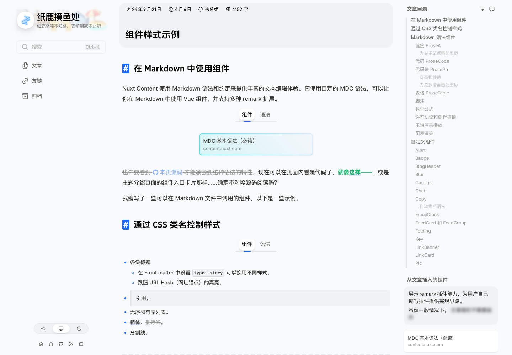

# 纸鹿博客 Clarity：值得借鉴的内容展示设计

> 体验日期：2026-10-23。定位：内容展示设计参考。仅作有限体验，不作为完整主题的安装、部署或全功能推荐。

Clarity 是基于 Nuxt Content 的个人博客主题。它值得看的地方是如何把长文章组织成更易阅读的页面：折叠、代码展示、提示、卡片、分组和图表都有具体示例。对准备使用 Nuxt Content 写博客的人，它是可以进一步考察的主题；对已经有 React 内容站的人，更适合按需借鉴设计。

本次取舍是保留评测与官方入口，不为查看这些组件另建一套博客，也不保留个人源码仓或 Fork。是否使用 Star 收藏可独立决定，本次没有修改收藏。

| 项目 | 信息 |
| --- | --- |
| 原项目 | [L33Z22L11/blog-v3](https://github.com/L33Z22L11/blog-v3) |
| 官方网站 | [纸鹿摸鱼处](https://blog.zhilu.site/) |
| 主题说明 | [Clarity 主题介绍](https://blog.zhilu.site/theme) |
| 本次体验页面 | [组件样式示例](https://blog.zhilu.site/previews/example) |
| 固定源码 | [381f1c1648a53d6f7aa8e351d521311af6da998d](https://github.com/L33Z22L11/blog-v3/tree/381f1c1648a53d6f7aa8e351d521311af6da998d)，package版本3.8.0 |
| 技术栈 | 固定版本使用 Nuxt 4、Content 3、Vue 3 |
| 许可 | 项目代码MIT；文章一般另按CC BY-NC-SA 4.0，具体文章以自身声明为准。组件示例页声明CC0 1.0 |

线上部署版本未与上述源码建立对应关系，不能把源码版本当成线上版本证明。

## 有什么通用价值

普通 Markdown 已经能表达标题、列表、引用和表格。写长教程时，补充说明、长代码、分组步骤和超宽图表会带来更多阅读负担。Clarity 提供了较完整的富内容示例，值得对照查看。

这张截图记录1440×1000桌面视口的页面样式，不是折叠展开的同屏证明。

| 能力 | 值得参考的部分 | 本次证据边界 |
| --- | --- | --- |
| 折叠与嵌套 | 把补充说明收起来，支持嵌套内容 | 一处父折叠实际展开、正文回读、再次关闭通过 |
| 代码展示 | 页面有文件名、换行、复制和长代码折叠等示例 | 只取得行内复制示例，代码块各项操作没有完整验证 |
| 图表阅读 | 固定源码考虑接近视口再加载、等待字体测量、主题重绘和宽度适配 | 仅源码核对与页面功能说明，未实测主题、窄屏、错误态 |
| 提示、卡片和分组 | 可用于步骤说明、关联阅读及较复杂教程的组织 | 官方页面可查看示例，未逐项交互验收 |

它的通用性在阅读设计层面。Vue组件和MDC语法依赖相应内容管线，不是能直接导入任意框架的通用组件包；也不能仅凭文章样式推断它具备完整CMS后台能力。

## 实际体验与限制

使用已安装 Chrome 的独立临时配置，1440×1000，无登录账号。官方组件示例页正常打开，正文可读，没有账号前置。

实际检查一处嵌套折叠：父折叠初始关闭，点击后展开，能读到嵌套说明，再次点击收起。这个结论来自交互后的DOM状态及正文回读。

复制测试发生了目标选择错误：脚本把页面中第一个复制按钮当作代码块按钮，期待得到“纯文本代码块”，实际剪贴板得到的是页面行内示例`pnpm dev`，因此断言失败。这不证明代码块复制有故障，也不能把该脚本写成全部通过；代码块复制仍属未验。

测试主动拦截了评论与统计等写请求，期间出现一次未处理Promise错误。在这个受限网络条件下，没有足够依据把它认定为网站原生缺陷。未登录、提交评论、上传文件、安装依赖或运行整站；没有继续手机、主题、图表及其他组件的全量测试。临时浏览器已关闭。

## 是否值得保留项目

对于现有 React Markdown/GFM 内容站，直接维护另一套 Nuxt 博客并不划算。出现具体长教程需求时，可以选择最有用的折叠、代码或图表行为，在现有渲染层设计相应语法和实现，而不是把所有组件一次搬过去。

因此保留官方示例、源码链接和这份评测就足够。旧版本源码与上游文章没有额外的个人业务价值，不保留为长期开发资产；也不把作者文章复制到自己的内容库。未来真要选用整套主题，应另做安装、构建、配置和发布验证。

截图来自对公开组件示例的实际浏览，已保留作者及项目标识。第三方页面、文字和资产遵循各自许可；本仓原创评测文字的许可不改变第三方授权。
