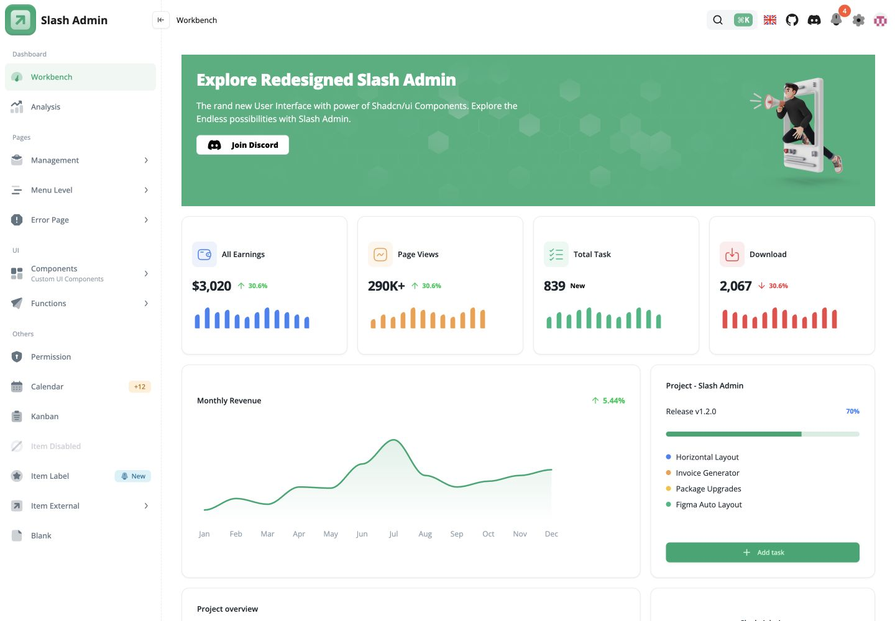
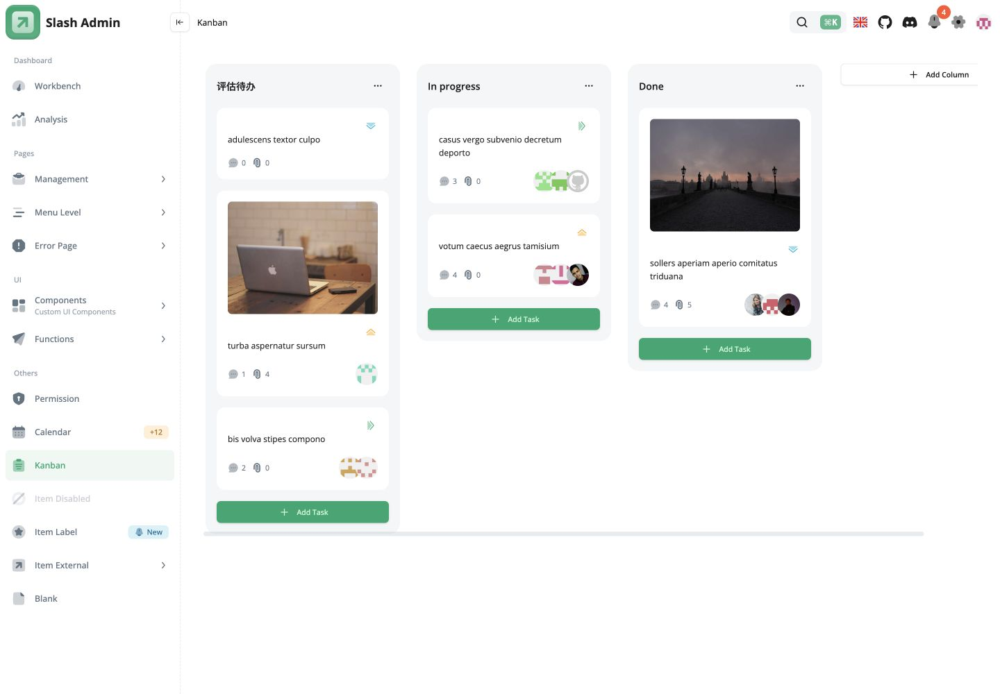

# Slash Admin：值得保留的后台交互样板

> 评测日期：2026-10-23；定位：前端学习与选型参考。保留独立参考副本，不作为接入真实业务后端的成品推荐。

Slash Admin 的价值在于把权限反馈、菜单、看板和后台布局放进一个可以试用的 React 工程。相比只保存几段组件代码，完整样例可以帮助理解路由、状态与权限表现如何配合。这是本次选择保留独立参考副本的原因；不代表需要整体替换现有后台，也不因此创建个人 Fork。

| 项目 | 信息 |
| --- | --- |
| 原项目 | [dingyi214/slash-admin](https://github.com/dingyi214/slash-admin)，原d3george地址已迁移 |
| 固定体验版本 | [63e113c241b2a87f823b14cee2ec2961a8356dbc](https://github.com/dingyi214/slash-admin/tree/63e113c241b2a87f823b14cee2ec2961a8356dbc) |
| 官方体验 | [Demo](https://admin.slashspaces.com/)，此前测试时连接失败，本轮未重新验证 |
| 官方文档 | [Slash Admin文档](https://docs-admin.slashspaces.com/) |
| 技术栈 | React19、Vite、TypeScript、shadcn/ui、Ant Design、Zustand、React Query，MSW/Faker模拟数据 |
| 许可 | [MIT](https://github.com/dingyi214/slash-admin/blob/63e113c241b2a87f823b14cee2ec2961a8356dbc/LICENSE) |

## 为什么值得作为独立样板保留

对于只需要常规列表和表单的轻量后台，已有底座通常足够，Slash Admin的整套壳会带来额外依赖和适配成本。它更适合用来学习稍复杂的交互组织，和其他后台样板作对照。

| 场景 | 可借鉴的能力 | 不能直接推导的能力 |
| --- | --- | --- |
| 权限反馈 | 按角色演示页面、按钮及函数层面的不同表现，包含403页 | 不等于真实服务端授权或安全验收 |
| 看板 | 列菜单、任务卡片、状态与页面布局如何组合 | 不等于持久化任务系统；刷新后修改会复位 |
| 菜单和后台壳 | 多级菜单、路由和后台布局组织 | 不需要为了换皮整体引入另一套壳 |
| 日历 | 项目有FullCalendar相关页面及组件实现 | 本次没有完整验证创建、编辑、跨日和保存流程 |

与shadcn-admin相比，本轮核对到了更明确的权限演示页、看板和完整日历页面。shadcn-admin中的基础日历控件不等于完整日程功能。这是具体源码范围内的对照，不是对所有版本作功能排名。

## 实际验证了什么

本次文章复用了同日较早完成的固定版本试用证据。复核时，当前参考副本相对该版本只有README、参考说明和隔离预览配置变化，业务源码没有变化，因此没有再次安装、构建或启动浏览器。

此前冻结锁文件并禁用安装脚本后，类型检查、生产构建通过。实际使用Node26.3.0、pnpm10.8.0；上游声明Node20.x，运行通过不能扩大成对Node26的官方支持承诺。

桌面1440×1000与手机390×844检查过：mock登录、工作台、看板列重命名与刷新复位、访客权限回退和403、手机侧栏开关。截图来自该次本机试用，不是官方Demo，也不是本轮新运行的结果。

已知局限：

- 看板改名在刷新后丢失，属于页面模拟状态；不承诺任务持久化。
- 手机选择菜单后侧栏未自动收起，看板需要横向滚动。
- 隔离本机预览时Vercel统计脚本返回HTML，控制台出现两次语法错误；主路径可用，但不是零错误验收。
- 构建有大分包警告，依赖同时包含多套界面和图表方案，采用时要评估裁剪成本。
- 未完整验证注册、密码找回、日历、拖拽边界或真实后端。

这些限制影响它作为成品的推荐程度，不抹掉其作为交互样板的学习价值。

## 保留方式

保留一个固定版本的独立本地参考副本，按需运行，不常驻服务、不自动追更。学习和公开评测优先指向上游；没有自行维护分支或提交修复的需求时，不额外建立个人Fork。

已有业务继续使用自己的底座；真正采用某个权限或看板模式时，另行设计真实接口、持久化和后端授权。这份评测不把“样例能点”当成“业务已经实现”。

截图中的资料为公开项目提供的模拟内容。第三方标识、图片及其他资产遵循其原有权利和许可，本仓评测文字的许可不改变这些授权。
