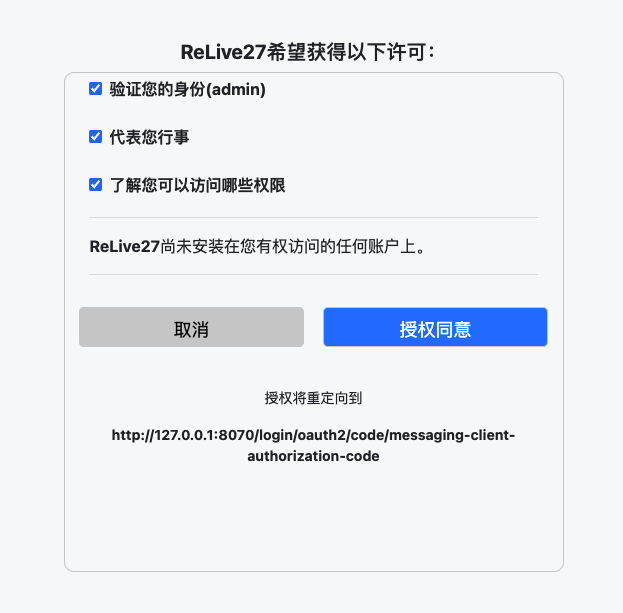

# Spring Security OAuth2 Sample：按协议问题查找的示例集

[官方仓库](https://github.com/ReLive27/spring-security-oauth2-sample) · [阅读版本](https://github.com/ReLive27/spring-security-oauth2-sample/tree/b3b58613499a88374323c4c14b426f0207dea274) · [Apache-2.0许可](https://github.com/ReLive27/spring-security-oauth2-sample/blob/b3b58613499a88374323c4c14b426f0207dea274/LICENSE)

## 适合谁

正在学习或接入Spring Security / Spring Authorization Server，需要对照客户端、授权服务器与资源服务器配置的Java开发者。它适合按问题读一组小示例，不能当作完整身份平台直接上线。

## 值得看什么

| 问题 | 示例入口 |
| --- | --- |
| 授权码与PKCE怎样配合 | [oauth2-pkce](https://github.com/ReLive27/spring-security-oauth2-sample/tree/b3b58613499a88374323c4c14b426f0207dea274/oauth2-pkce) |
| 如何组织用户授权同意页 | [custom-consent](https://github.com/ReLive27/spring-security-oauth2-sample/tree/b3b58613499a88374323c4c14b426f0207dea274/oauth2-custom-consent-authorizationserver) |
| 验签公钥、轮换和缓存怎么分工 | [oauth2-jwk-redis](https://github.com/ReLive27/spring-security-oauth2-sample/tree/b3b58613499a88374323c4c14b426f0207dea274/oauth2-jwk-redis) |
| JWT验证与在线内省有什么区别 | [introspection-with-jwt](https://github.com/ReLive27/spring-security-oauth2-sample/tree/b3b58613499a88374323c4c14b426f0207dea274/oauth2-introspection-with-jwt) |

还有OAuth登录、OIDC、客户端持久化、opaque token和网关集成等专题。客户端与授权/资源服务分开，便于看清谁发起授权、谁签发令牌、谁执行访问控制。

图片来自[上游示例](https://github.com/ReLive27/spring-security-oauth2-sample/blob/b3b58613499a88374323c4c14b426f0207dea274/oauth2-custom-consent-authorizationserver/image/custom-page.png)，展示授权范围与回调地址；这是作者截图，不是本机运行验收。

## 主要限制

截至2026-10-30，上游240 Star、Apache-2.0、未归档。阅读main固定提交的根POM为Boot3.3.0/Java17，另有多个SAS版本分支；不要混用不同分支的API。最近2026-03-08提交主要补充文档注释，近几次还有2025年的说明和修复，不能据推送时间称为高频功能更新。

各专题依赖不同，部分需要Redis、Consul或数据库，也包含演示连接/客户端配置。应只选要研究的模块，按实际版本和接入系统重新验证。

缓存与内省示例尤其需要理解边界：JWKS缓存不是授权状态缓存；缓存active结果会影响撤销实时性。示例直接以token作为缓存键，采用前要处理凭据保护、TTL与令牌过期关系；自定义JWT校验器也需核对issuer、audience与scope，不能只确认签名或时间。

## 结论

**值得作为OAuth2专题源码参考。** 优先按具体问题选模块，结合当前官方文档理解接口和安全边界；不建议整仓当成现成认证产品，未验证的示例不作生产可用承诺。

依据：2026-10-30固定源码、版本分支及官方同意页截图阅读；未运行完整授权流程、Redis/Consul或数据库，未做安全审计。
