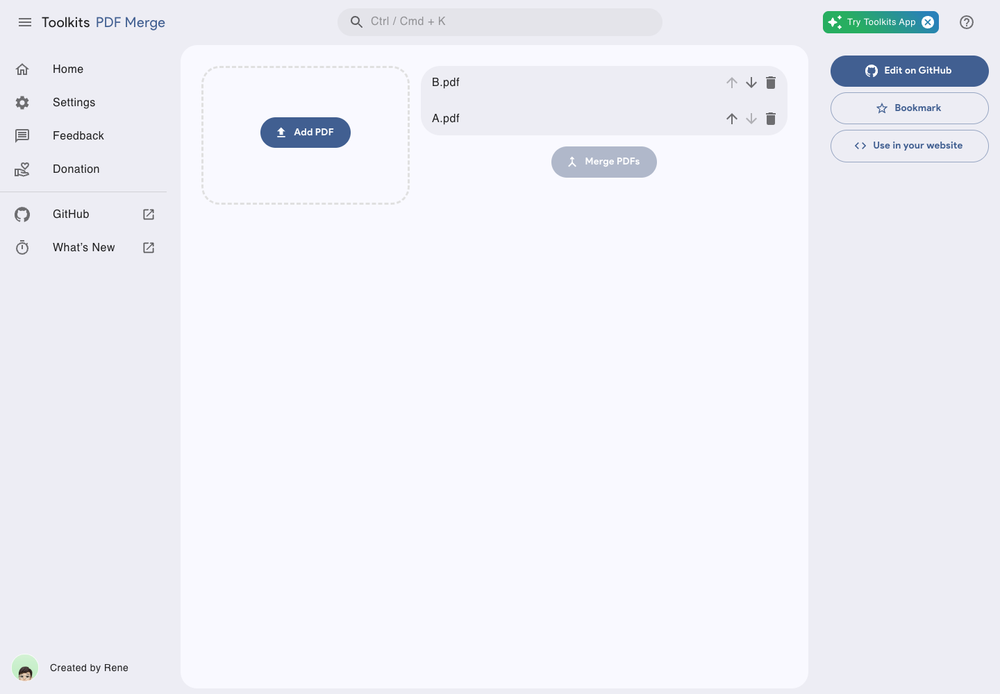
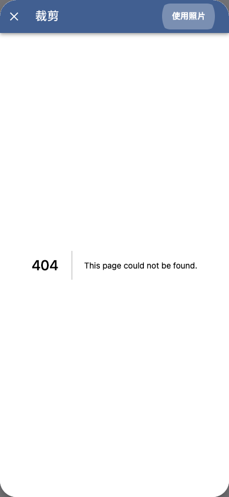

# Toolkits：PDF合并有限可用，九宫格暂不推荐

[原项目](https://github.com/rivertwilight/toolkits) · [网站](https://tlkts.com/)

## 适合谁

偶尔需要把普通PDF按顺序合并，希望直接在浏览器完成操作的人。

## 价值与不足

[PDF合并](https://tlkts.com/en-US/app/pdf_merger)的正常添加、排序、删除和下载流程可用，桌面与手机都完成过定向体验。损坏或加密PDF的错误提示不够明确，不适合直接依赖它处理复杂文件。

[九宫格切图](https://tlkts.com/en-US/app/grid_splitter)在体验时卡在裁剪页404，未生成九宫格或ZIP。

## 结论

普通PDF可在了解限制后尝试；九宫格暂不推荐，其他工具不据此作判断。不要把整个网站当成已验收的离线工具，敏感文件应自行核对数据处理方式。

依据：2026-10-23定向试用；网站可能更新，源码与线上部署版本未建立对应。上游Apache-2.0，截图内第三方资产遵循原有权利。
